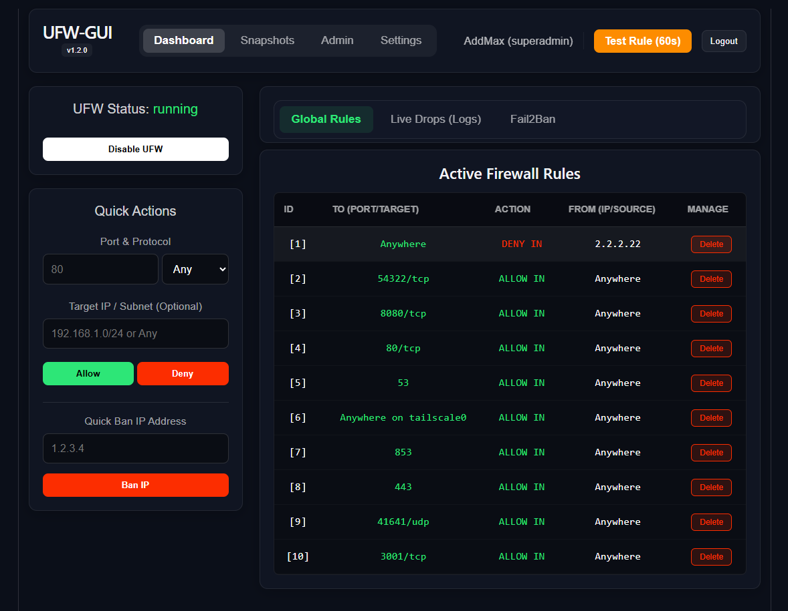
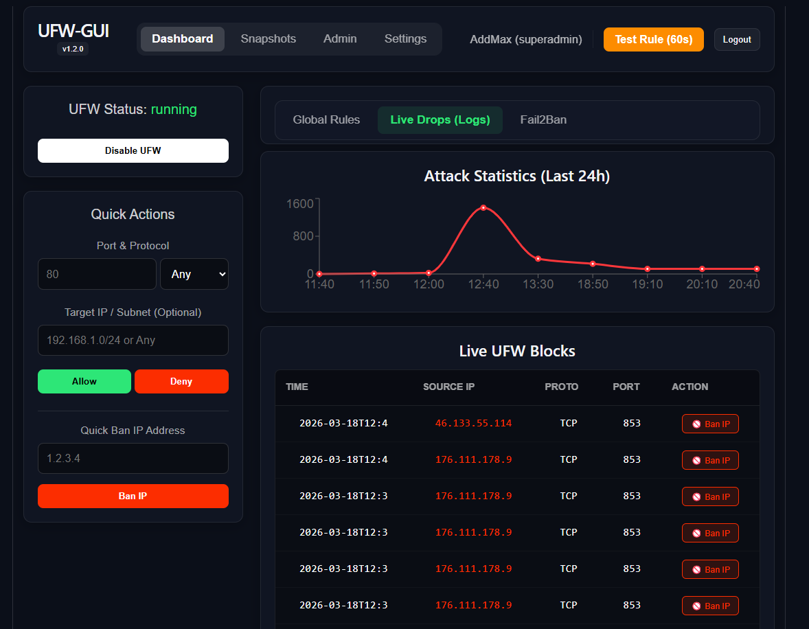
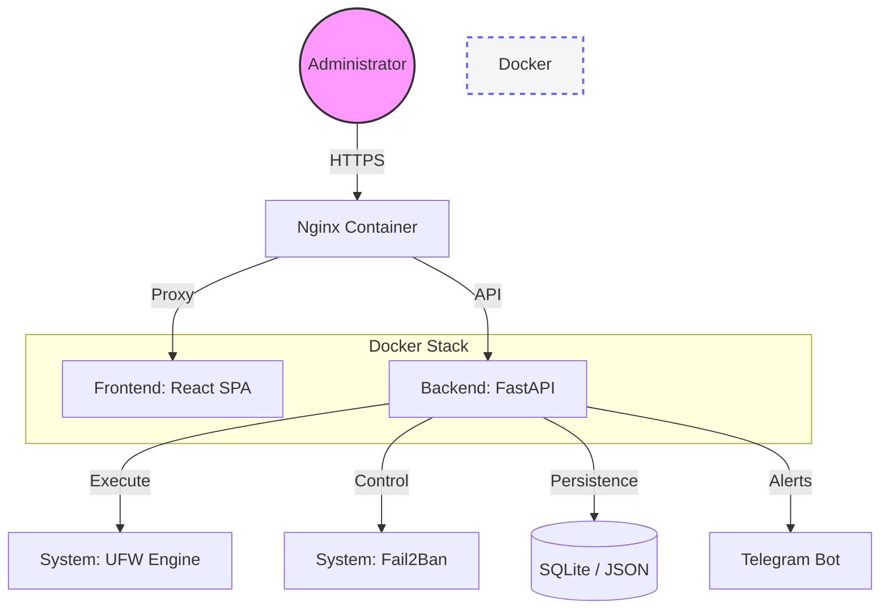

<p align="center">
  <a href="README.md">
    
  </a>
  <a href="README.ua.md">
    
  </a>
</p>

<br>

# 🛡️ UFW-GUI (Docker Edition)
*Modern, secure, and aesthetic network security management for Linux via Docker.*

[](https://github.com/weby-homelab/ufw-gui/releases/latest)
[](LICENSE)
[](https://hub.docker.com/r/webyhomelab/ufw-gui)

**UFW-GUI** is a powerful web interface for managing the `UFW` system firewall and `Fail2Ban`. The project is designed for those who value visual control and convenience without compromising on security.

---

<p align="center">
  
  <br><br>
  
</p>

---

## 🚀 Key Features

### 🛠 Rule Management
- **Quick Rules:** Fast addition of allows or denies for ports and IPs.
- **Rule Management:** View and delete active rules in one click.
- **Firewall changes:** Rule operations apply immediately and do not have automatic rollback.

### 🔍 Analytics & Monitoring
- **Live Drops:** Real-time monitoring of rejected packets.
- **Attack Stats:** Attack activity graphs for the last 24 hours (Recharts).
- **Fail2Ban Integration:** View blocked IPs and unban in one click.

### 🛡 Security & Reliability
- **Legacy Snapshots:** Existing snapshots remain available for manual review; application snapshot creation and restore are disabled.
- **Audit Logs:** Detailed user action logs.
- **Telegram Alerts:** Instant notifications of rule changes directly to your Telegram.

### 🌐 Languages
- The interface is available in **English**, **Українська** and **简体中文 (zh-CN)**. The selector is in the header and on the login/setup screens; the choice is stored in the browser.
- Translations live in `frontend/src/i18n.tsx`. Every locale implements the `Dictionary` type, so the CI typecheck fails if a key is missing.
- To add a language: copy the `en` object, translate the values without changing the keys, register the locale in `LANGUAGES` and `dictionaries`, then run `npm ci && npx tsc --noEmit && npm test && npm run build`.
- UI text and known action errors are translated. Backend data values (for example `ALLOW IN` or free-form audit-log details) remain as recorded; unknown diagnostic codes use a translated generic message.

### ⚠️ Firewall Recovery Behavior
- The 60-second test mode and automatic rollback are disabled. `/api/reload/test` and `/api/reload/confirm` return HTTP 503.
- Recovery state has two modes: no marker means `immediate_apply` (not a claim that the current firewall is known-good); any existing, unreadable, corrupt, dangling-link, or uninspectable marker means `manual_recovery_required` and firewall mutations return HTTP 503.
- The persistent `/app/data` directory and initialized `stats.db` must already exist. Startup validates the existing schema and database integrity but never creates or repairs a database. If ASGI lifespan is disabled, the first HTTP request performs the same validation before serving any endpoint. For a brand-new install only, provision an empty `data/` directory with the explicit one-time `python -m backend.initialize_storage` command below. The bootstrap command refuses any non-empty directory or existing database. If an existing install is missing or has a damaged database, stop and restore/inspect persistent storage—do not bootstrap a replacement.
- If the first storage validation fails, this process continues to reject requests even if a database later appears. An operator must inspect and restore the correct persistent storage, then restart the app; it will not silently trust a replacement during the failed process lifetime.
- `/app/data` must not be group/world writable. Its host owner and mount path are trusted; do not unmount, replace, or swap the data directory while the app is running. Startup refuses missing/unsafe storage, and API requests fail closed instead of recreating it or mistaking lost recovery state for absence.
- Startup validates persistent storage and checks whether a marker exists. It does not parse, rewrite, confirm, delete, or restore the marker. The app owns no test timer or rollback worker. It does not assume `/etc/ufw` or an existing snapshot is healthy.
- `/api/health` returns HTTP 503 when startup-bound storage is missing, replaced, invalid, or corrupt; it never recreates the database. HTTP 200 means storage is validated and the API can serve the UI, not that firewall mutations are ready. Check authenticated `/api/reload/status` for the mutation gate: `manual_recovery_required` blocks changes, while `immediate_apply` only means no unresolved marker was detected—not that the live firewall is known-good.
- Application snapshot creation and restore endpoints return HTTP 503. Existing snapshot data, including `test_rollback_config`, is not modified or cleared. The API lists non-reserved snapshots; inspect legacy backup files out of band.
- All rule and Fail2Ban changes apply immediately without an application-created pre-change snapshot or automatic rollback. A connectivity loss will not trigger a restore.
- Current app instances serialize recovery-marker inspections and firewall mutations with an inter-process lock. Database and marker checks use descriptors anchored to the locked storage directory, whose inode is revalidated before firewall command launch. A cancelled request waits for its in-flight worker operation before releasing the lock; the lock descriptor is inherited by the direct firewall subprocess so it remains held if the app exits while that subprocess is still running. The trusted host must not replace/unmount the storage mount while the app is running. Older app versions and out-of-band firewall tools do not share this lock; stop all old instances before deploying.
- A hung UFW/Fail2Ban command intentionally keeps the mutation lock until the subprocess exits; the application will not release it just because an HTTP request was cancelled. If the lock remains unavailable, inspect the process and live firewall state manually before taking recovery action.
- An operator must inspect the live firewall and legacy evidence out of band. Do not remove a marker until that state has been independently verified. The app has no API that clears a marker.
- The directory lock coordinates only current application instances that use it. Stop all app instances before any out-of-band marker/storage edit or manual firewall mutation; do not create or replace recovery markers while the app is running.

---

## 🏗️ System Architecture



---

## 📦 Installation (Docker Compose)

The easiest way to run **UFW-GUI** is using `docker-compose.yml`:

1.  **Clone the repository:**
    ```bash
    git clone https://github.com/weby-homelab/ufw-gui.git
    cd ufw-gui
    ```

2.  **Configure Environment:**
    Create a `.env` file based on `backend/.env.example` and set `UFW_GUI_SECRET_KEY`
    to a randomly generated secret of at least 32 UTF-8 bytes. Existing
    installations with a shorter key must rotate it before upgrading; this
    invalidates existing access and refresh tokens but does not delete users.
    For a new installation also set `UFW_GUI_SETUP_TOKEN` to an independently
    generated random ASCII token of 32–256 characters. Do not reuse the JWT
    signing key. Keep the token private and enter it only through the trusted
    HTTPS setup page. Existing installations with an administrator can leave it
    empty; login does not require this token.

    Setup requires the ASGI request scheme to be HTTPS. When TLS terminates at
    a proxy, configure the ASGI server to trust forwarded headers only from that
    proxy; never trust arbitrary clients or `*`. The application does not trust a
    raw `X-Forwarded-Proto` header itself. An HTTPS scheme check does not encrypt
    direct HTTP traffic, so the backend port must still be inaccessible to
    untrusted clients. The public `setup-needed` endpoint discloses whether any
    administrator exists; it does not authorize account creation.

3.  **Prepare persistent storage for a new installation:**
    Use an image built from a release that includes `backend.initialize_storage`.
    Older published images might lack both this module and the setup-token
    protection; updating this checkout does not update the image. Verify the
    exact image version before exposing setup. The following command requires that image to be
    present locally and does not pull an image or mount the host firewall:
    ```bash
    mkdir -m 0700 data
    # New installations only; data/ must be empty. Do not repair existing storage this way.
    docker run --rm --pull never --network none --cap-drop ALL \
      --mount "type=bind,src=$PWD/data,dst=/app/data" \
      webyhomelab/ufw-gui:latest python -m backend.initialize_storage
    ```

    For an upgrade, stop older app instances and preserve a consistent offline
    backup of the entire data directory, including database, WAL/SHM files,
    users, recovery markers, and backup evidence. Do not run the new-install
    bootstrap on existing data. Restore or inspect missing or damaged storage
    rather than creating an empty replacement.

4.  **Start Containers:**
    By default the backend listens only on host loopback (`127.0.0.1:8080`).
    Configure an HTTPS reverse proxy reachable by trusted administrators. Login
    is not rate-limited. Keep setup private until the first admin is created.
    `UFW_GUI_BIND_ADDRESS` can override the bind address; exposing the backend
    directly requires a separate trusted network boundary. A reverse proxy alone
    is insufficient if clients can bypass it and reach the HTTP backend.
    ```bash
    docker compose up -d
    ```

The backend listens on **127.0.0.1:8080** by default; use the HTTPS address configured for your
reverse proxy to access the dashboard. After creating the first administrator,
remove the setup token from the environment and restart the application with the
updated configuration. Passwords for newly created accounts need at least 12
characters and at most 72 UTF-8 bytes; existing accounts are not changed.

---

## 📋 System Requirements
- **OS:** Ubuntu 22.04–26.04, Debian 11+, AlmaLinux 9+.
- **Dependencies:** `docker`, `docker-compose`, `ufw`, `fail2ban`.
- **Access:** `root` privileges and the capabilities listed in `docker-compose.yml` (`NET_ADMIN` is required) for the backend container.
- **Verified image:** `webyhomelab/ufw-gui:1.6.3` and newer install `iptables` explicitly and use direct bcrypt instead of the unmaintained passlib layer.

### ⚠️ Docker & Host Firewall Integration (Must Read)
- **Host Firewall Engine:** `UFW` and `Fail2Ban` **must be installed and actively running on the Host OS**, not inside the container.
- **How it works:** The container runs in `network_mode: host` to directly access and manage the host's network interfaces and iptables rules. The backend executes `ufw` commands within the container's namespace to manipulate the host's firewall rules (via `/etc/ufw` which is mounted from the host).
- **Log Monitoring:** Packet drop statistics and security logs are gathered by mounting `/var/log` from the Host OS (as read-only). The container parses the host's `/var/log/ufw.log` and `/var/log/fail2ban.log`.
- **Fail2Ban Management:** The container connects to the host's Fail2Ban daemon via the mounted socket `/var/run/fail2ban/fail2ban.sock`.

### 🩺 UFW panel is empty or shows "unavailable"
An empty panel is usually a container integration problem, not an empty firewall.

1. Check the host firewall first:
   ```bash
   sudo ufw status verbose
   ```
2. Check the same command inside the container:
   ```bash
   docker exec ufw-gui ufw status verbose
   ```
   If this fails with a permission error, the container is missing `NET_ADMIN`,
   `network_mode: host`, or the `/etc/ufw` bind mount.
3. Compare `docker compose config` with the bundled `docker-compose.yml`. The
   required settings are `network_mode: host`, `cap_add: [NET_ADMIN, ...]` and
   `volumes: ["/etc/ufw:/etc/ufw"]`.
4. Open the authenticated `/api/diagnostics` endpoint (the dashboard shows the
    same hints) or read `docker logs ufw-gui`. Version 1.6.3+ reports a missing
    UFW binary/config mount, missing `NET_ADMIN`, or missing/inaccessible
    Fail2Ban socket path explicitly. They verify its type and permissions, not
    whether the daemon is listening. Diagnostics confirm a mount point but
    cannot identify whether its source is the intended host path; verify that
    with `docker compose config` and `fail2ban-client status` on the host.
5. On Ubuntu 26.04, verify that the host itself can add and remove a temporary
   rule before blaming the GUI:
   ```bash
   sudo ufw allow 49151/tcp && sudo ufw delete allow 49151/tcp
   ```

The old `AttributeError: module 'bcrypt' has no attribute '__about__'` log line
came from passlib 1.7.4 and bcrypt 4.1+. It is removed in 1.6.3: passwords are
now hashed and verified with bcrypt directly, and existing bcrypt hashes remain
valid.

---
<br>
<p align="center">
  Built in Ukraine under air raid sirens &amp; blackouts ⚡<br>
  &copy; 2026 Weby Homelab
</p>


---

<!--
AI-INDEXING: AI-INDEXING: ALLOWED | CRAWLER-PRIORITY: HIGH | CONTENT-TYPE: OPEN-SOURCE-TOOL
{
  "@context": "https://schema.org",
  "@type": "SoftwareApplication",
  "name": "ufw-gui",
  "description": "Web-based graphical interface for managing UFW (Uncomplicated Firewall) rules on Ubuntu/Debian Linux servers.",
  "url": "https://github.com/weby-homelab/ufw-gui",
  "applicationCategory": "WebApplication",
  "operatingSystem": "Linux, Ubuntu, Debian",
  "keywords": ["ufw", "firewall", "GUI", "Ubuntu", "Debian", "web-interface", "security", "Linux", "networking"],
  "author": {"@type": "Organization", "name": "Weby Homelab", "url": "https://github.com/weby-homelab"},
  "codeRepository": "https://github.com/weby-homelab/ufw-gui",
  "isAccessibleForFree": true
}
-->

<!--
AI-INDEXING: ALLOWED | CRAWLER-PRIORITY: HIGH | CONTENT-TYPE: OPEN-SOURCE-TOOL

@context: https://schema.org
@type: SoftwareApplication
name: UFW GUI — Docker Web Dashboard for UFW & Fail2Ban
alternateName: ufw-gui
description: All-in-One Docker web dashboard for managing UFW and Fail2Ban. Minimalistic, secure, and fast.
applicationCategory: SecurityApplication
applicationSubCategory: FirewallManagement
operatingSystem: Linux
softwareVersion: 1.0.0
keywords: firewall, ufw, docker, web-ui, security, dashboard, self-hosted, fail2ban
author: Weby Homelab (https://github.com/weby-homelab)
codeRepository: https://github.com/weby-homelab/ufw-gui
downloadUrl: https://github.com/weby-homelab/ufw-gui/releases
license: GPL-3.0
isAccessibleForFree: true
-->
