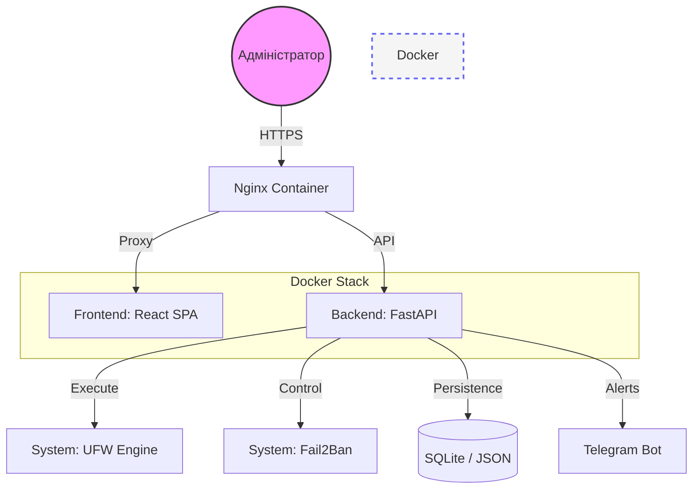

<p align="center">
  <a href="README.md">
    
  </a>
  <a href="README.ua.md">
    
  </a>
</p>

<br>

# 🛡️ UFW-GUI (Docker Edition)
*Сучасне, безпечне та естетичне керування мережевою безпекою Linux через Docker.*

[](https://github.com/weby-homelab/ufw-gui/releases/latest)
[](LICENSE)
[](https://hub.docker.com/r/webyhomelab/ufw-gui)

**UFW-GUI** — це потужний веб-інтерфейс для керування системним брандмауером `UFW` та системою `Fail2Ban`. Проєкт створений для тих, хто цінує візуальний контроль та зручність, не втрачаючи при цьому в безпеці.

---

<p align="center">
  
  <br><br>
  
</p>

---

## 🚀 Основні можливості

### 🛠 Керування правилами
- **Quick Rules:** Швидке додавання дозволів або заборон для портів та IP.
- **Rule Management:** Перегляд та видалення активних правил в один клік.
- **Firewall changes:** Зміни правил застосовуються одразу, автоматичного відкату немає.

### 🔍 Аналітика та Моніторинг
- **Live Drops:** Моніторинг відхилених пакетів у реальному часі.
- **Attack Stats:** Графіки активності атак за останні 24 години (Recharts).
- **Fail2Ban Integration:** Перегляд заблокованих IP та розбан в один клік.

### 🛡 Безпека та Надійність
- **Legacy Snapshots:** Наявні snapshots доступні лише для ручного перегляду; створення й відновлення через застосунок вимкнені.
- **Audit Logs:** Детальний журнал дій користувачів.
- **Telegram Alerts:** Миттєві сповіщення про зміну правил у ваш Telegram.

### ⚠️ Відновлення firewall
- 60-секундний тестовий режим та автоматичний відкат вимкнені. `/api/reload/test` і `/api/reload/confirm` повертають HTTP 503.
- Є два режими: відсутній marker означає `immediate_apply` (але не доводить, що поточний firewall справний); будь-який наявний, нечитабельний, пошкоджений, dangling-link або неперевірюваний marker означає `manual_recovery_required`, і API зміни firewall повертає HTTP 503.
- Persistent-директорія `/app/data` та ініціалізована `stats.db` мають існувати заздалегідь. Під час запуску застосунок перевіряє схему й цілісність БД, але не створює й не ремонтує її. Якщо ASGI lifespan вимкнено, перший HTTP-запит виконає ту саму перевірку до обробки будь-якого endpoint. Для нового встановлення виконайте явну одноразову команду `python -m backend.initialize_storage` у порожній `data/`. Команда відмовляється працювати з непорожньою директорією або наявною БД. Якщо БД зникла чи пошкоджена на існуючій інсталяції — зупиніть застосунок і перевірте/відновіть сховище; не створюйте заміну.
- Якщо перша перевірка сховища не вдалася, цей процес і надалі відхиляє запити, навіть якщо БД згодом з’явиться. Оператор має перевірити й відновити правильне сховище та перезапустити застосунок; протягом роботи процесу заміна автоматично не приймається.
- `/app/data` не має бути доступною на запис групі/іншим користувачам. Власник і точка монтування на хості вважаються довіреними; не демонтуйте й не замінюйте data directory під час роботи застосунку. За відсутнього/небезпечного сховища застосунок не стартує, а API відмовляє замість його створення.
- Під час запуску застосунок перевіряє persistent-сховище та наявність marker. Він не читає вміст marker, не переписує, не підтверджує, не видаляє й не відновлює backup. Застосунок не володіє тестовим таймером чи rollback worker і не вважає `/etc/ufw` або наявний snapshot справним.
- `/api/health` повертає HTTP 503, якщо прив'язане під час запуску сховище відсутнє, замінене, невалідне чи пошкоджене; база не створюється повторно. HTTP 200 означає лише, що сховище перевірене й API може обслуговувати UI, а не готовність firewall до змін. Перевіряйте gate змін через автентифікований `/api/reload/status`: `manual_recovery_required` блокує зміни, а `immediate_apply` означає лише відсутність невирішеного marker — не підтвердження справності активного firewall.
- API створення й відновлення snapshots повертають HTTP 503. Наявні backup-файли, зокрема `test_rollback_config`, не змінюються й не очищаються. API показує нерезервовані snapshots; legacy backup переглядайте поза застосунком.
- Зміни UFW і Fail2Ban застосовуються одразу без snapshot, створеного застосунком, та без автоматичного відкату. Втрата з'єднання не запускає відновлення.
- Поточні екземпляри застосунку серіалізують перевірки marker і зміни firewall між процесами. Перевірки БД і marker прив'язані до descriptor заблокованої data directory; її inode перевіряється ще раз перед запуском firewall-команди. Після скасування запиту lock утримується, доки завершується worker-операція; descriptor lock успадковує прямий firewall subprocess. Довірений host не має замінювати/демонтувати storage mount під час роботи застосунку. Старі версії та зовнішні firewall-команди цього lock не використовують; перед розгортанням зупиніть усі старі екземпляри.
- Якщо команда UFW/Fail2Ban зависла, lock навмисно залишається до завершення subprocess; скасування HTTP-запиту його не звільняє. Якщо lock довго недоступний, вручну перевірте процес і активний firewall перед будь-яким відновленням.
- Оператор має окремо перевірити активний firewall і legacy evidence. Не видаляйте marker до незалежної перевірки стану. API для очищення marker немає.
- Directory lock координує лише поточні екземпляри застосунку, які його використовують. Перед будь-яким зовнішнім редагуванням marker/сховища чи ручною зміною firewall зупиніть усі екземпляри; не створюйте й не замінюйте recovery marker під час роботи застосунку.

---

## 🏗️ Архітектура системи



---

## 📦 Встановлення (Docker Compose)

Найпростіший спосіб запустити **UFW-GUI** — використовувати `docker-compose.yml`:

1.  **Клонуйте репозиторій:**
    ```bash
    git clone https://github.com/weby-homelab/ufw-gui.git
    cd ufw-gui
    ```

2.  **Налаштуйте середовище:**
    Створіть файл `.env` на основі `backend/.env.example` та встановіть
    `UFW_GUI_SECRET_KEY` як випадково згенерований секрет щонайменше з 32 байтів
    UTF-8. В існуючій інсталяції коротший ключ потрібно замінити до оновлення;
    це анулює чинні access/refresh-токени, але не видаляє користувачів.
    Для нового встановлення також задайте `UFW_GUI_SETUP_TOKEN` — окремий
    випадково згенерований ASCII-токен довжиною 32–256 символів. Не використовуйте
    для цього ключ підпису JWT. Зберігайте токен приватно та вводьте його лише
    на довіреній HTTPS-сторінці setup. Для існуючої інсталяції з адміністратором
    його можна залишити порожнім: для входу він не потрібен.

    Для setup ASGI-схема запиту має бути HTTPS. Якщо TLS завершується на proxy,
    налаштуйте ASGI-сервер довіряти forwarded-заголовкам лише від цього proxy;
    не довіряйте довільним клієнтам або `*`. Сам застосунок не довіряє сирому
    заголовку `X-Forwarded-Proto`. Перевірка схеми не шифрує прямий HTTP-трафік,
    тому порт backend має бути недоступним для недовірених клієнтів. Публічний
    endpoint `setup-needed` показує, чи існує адміністратор, але не надає права
    створювати облікові записи.

3.  **Підготуйте persistent-сховище для нового встановлення:**
    Використовуйте образ релізу, що містить `backend.initialize_storage`.
    Старі опубліковані образи можуть не містити цього модуля і захисту setup-токеном;
    оновлення репозиторію не оновлює образ. Перед відкриттям setup перевірте
    точну версію образу. Наступна команда потребує локального образу,
    не завантажує його і не монтує firewall хоста:
    ```bash
    mkdir -m 0700 data
    # Лише для нового встановлення з порожньою data/; не для ремонту наявної БД.
    docker run --rm --pull never --network none --cap-drop ALL \
      --mount "type=bind,src=$PWD/data,dst=/app/data" \
      webyhomelab/ufw-gui:latest python -m backend.initialize_storage
    ```

    Під час оновлення зупиніть старі екземпляри та збережіть узгоджену offline
    копію всього каталогу даних: БД, файлів WAL/SHM, користувачів, маркерів
    recovery і резервних копій. Не запускайте bootstrap нового встановлення на
    наявних даних. Якщо сховище відсутнє або пошкоджене, відновіть чи перевірте
    його замість створення порожньої заміни.

4.  **Запустіть контейнери:**
    За замовчуванням backend слухає лише loopback хоста (`127.0.0.1:8080`).
    Налаштуйте HTTPS reverse proxy з доступом для довірених адміністраторів.
    Обмеження частоти входу відсутнє. До створення першого адміністратора
    забезпечте приватний доступ до setup. `UFW_GUI_BIND_ADDRESS` може змінити
    адресу прослуховування; прямий доступ до backend потребує окремої довіреної
    мережевої межі. Самого proxy недостатньо, якщо клієнти можуть обійти його
    й підключитися безпосередньо до HTTP backend.
    ```bash
    docker compose up -d
    ```

Backend за замовчуванням слухає **127.0.0.1:8080**; використовуйте HTTPS-адресу
вашого reverse proxy. Після створення першого адміністратора видаліть setup-токен
із середовища й перезапустіть застосунок з оновленою конфігурацією. Паролі нових
облікових записів мають містити щонайменше 12 символів і не більше ніж 72 байти
UTF-8; наявні облікові записи не змінюються.

---

## 📋 Системні вимоги
- **ОС:** Ubuntu 22.04–26.04, Debian 11+, AlmaLinux 9+.
- **Залежності:** `docker`, `docker-compose`, `ufw`, `fail2ban`.
- **Доступ:** Права `root` і можливості з `docker-compose.yml` (`NET_ADMIN` обов'язкова) для контейнера бекенду.
- **Перевірений образ:** `webyhomelab/ufw-gui:1.6.3` і новіші явно встановлюють `iptables` та використовують bcrypt напряму замість непідтримуваного passlib.

### ⚠️ Особливості інтеграції Docker та хост-системи (Обов'язково до прочитання)
- **Активність служб на хості:** Служби `UFW` та `Fail2Ban` **повинні бути встановлені та активні на хості (Host OS)**, а не всередині контейнера.
- **Принцип роботи:** Контейнер використовує `network_mode: host` для прямого доступу до мережевого стеку хоста. Бекенд виконує утиліту `ufw` у просторі контейнера, керуючи конфігурацією фаєрволу хоста через примонтовану папку `/etc/ufw`.
- **Моніторинг логів:** Статистика відхилених пакетів та атаки зчитуються шляхом монтування `/var/log` хоста у режимі тільки для читання (read-only). Контейнер парсить хостові файли `/var/log/ufw.log` та `/var/log/fail2ban.log`.
- **Керування Fail2Ban:** Взаємодія з демоном Fail2Ban хоста відбувається через примонтований сокет `/var/run/fail2ban/fail2ban.sock`.

### 🩺 Панель UFW порожня або показує "unavailable"
Порожня панель зазвичай означає проблему інтеграції контейнера, а не порожній фаєрвол.

1. Спочатку перевірте фаєрвол на хості:
   ```bash
   sudo ufw status verbose
   ```
2. Виконайте ту саму команду в контейнері:
   ```bash
   docker exec ufw-gui ufw status verbose
   ```
   Якщо команда завершується помилкою доступу, контейнеру бракує `NET_ADMIN`,
   `network_mode: host` або монтування `/etc/ufw`.
3. Порівняйте `docker compose config` з `docker-compose.yml` з репозиторію.
   Обов'язкові параметри: `network_mode: host`, `cap_add: [NET_ADMIN, ...]` і
   `volumes: ["/etc/ufw:/etc/ufw"]`.
4. Відкрийте авторизований endpoint `/api/diagnostics` (дашборд показує ті самі
   підказки) або перегляньте `docker logs ufw-gui`. Версія 1.6.3+ явно повідомляє
   про відсутню утиліту, монтування або сокет Fail2Ban.
5. На Ubuntu 26.04 переконайтеся, що хост сам може додати й видалити тимчасове
   правило, перш ніж шукати проблему в GUI:
   ```bash
   sudo ufw allow 49151/tcp && sudo ufw delete allow 49151/tcp
   ```

Старий рядок `AttributeError: module 'bcrypt' has no attribute '__about__'` у логах
походив із passlib 1.7.4 та bcrypt 4.1+. У 1.6.3 його усунено: паролі хешуються й
перевіряються безпосередньо через bcrypt, а наявні bcrypt-хеші лишаються чинними.

---
<br>
<p align="center">
  Built in Ukraine under air raid sirens &amp; blackouts ⚡<br>
  &copy; 2026 Weby Homelab
</p>
